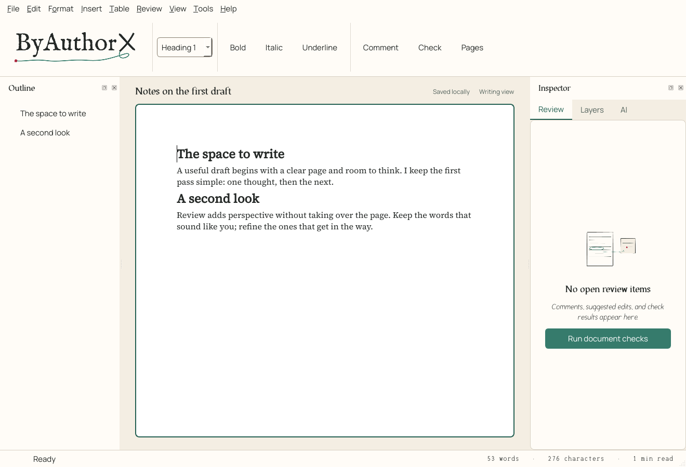

<picture>
  <source media="(prefers-color-scheme: dark)" srcset="docs/images/wordmark-dark.svg">
  
</picture>

# ByAuthorX

**Your words. Your call.**

A native desktop word processor with a shared, programmable document engine. Write in a Qt desktop editor, save editable `.byax` documents, inspect and edit through the CLI or MCP, and export through the same typography engine.

**Implementation status:** runnable development application, with automated engine, format, provider-contract, desktop, and integration tests. The complete product specification remains the acceptance target. See [the acceptance matrix](docs/acceptance-matrix.md) for verified behavior and material gaps; this repository does not claim all specification scenarios are complete. Windows 11 and Ubuntu 24.04 x64 are the intended installation targets. Live model services and physical desktop integrations require separate verification.



## Run from source

Python 3.11 or newer is required for development; frozen distributions include Python.

```bash
uv sync --extra dev
uv run byauthorx
```

Alternatively:

```bash
python -m venv .venv
# Ubuntu:
.venv/bin/python -m pip install -e ".[dev]"
.venv/bin/byauthorx
# Windows PowerShell:
.venv\Scripts\python -m pip install -e ".[dev]"
.venv\Scripts\byauthorx
```

On Ubuntu, install the native Qt dependencies documented in [compatibility](docs/compatibility.md). For headless PNG/PDF rendering set `QT_QPA_PLATFORM=offscreen`. Ordinary CLI editing and inspection need no desktop session.

## Desktop workflows

The editor includes a continuous writing view, a paginated preview, semantic outline, review and layer inspectors, native file dialogs/printing, formatting, tables/images, find/replace, undo/history, templates, local checks, and provider/dictation controls. `.byax` packages retain semantic identities, assets, review, source information, and history. Exporting does not replace the master. Imports and lossy exports return compatibility reports.

The Inspector's **AI** tab checks spelling locally (selection or whole document) with suggestions, exact replacements, a document dictionary, and session-only ignore. It also links to **Add or manage API keys…** and hosts an assistant chat with a persisted **Chat / Work** switch. Chat mode only answers and never changes the document. Work mode may suggest exact range edits, which are shown to you and, after confirmation, added to Review as pending proposals; nothing changes until you accept each one. Remote messages show the exact outbound payload for authorization unless the provider's saved policy allows remote calls.

Unconfigured AI functions do not prevent writing, saving, printing, or deterministic checks. Each provider requires a chosen model and local configuration; keys stay in OS credential storage or explicit environment references. No accounts, telemetry, or background model polling are required.

## Identity and motion

Warm paper, quiet ink, and familiar controls frame a clean writing page. Manrope is bundled for the interface; IM Fell English gives introductions their print character. Source Serif 4 is available as an optional document font. Your document keeps its chosen styles.

View and inspector changes use brief 180 ms transitions. Review, Outline, Layers, and the AI tab have small empty-state illustrations from the logo companion library; a writing/erasing pen loop appears only while work is running. In the AI tab, the red ink blot breathes only while the assistant is thinking, and a green margin gesture writes only while spelling is being checked. Explicit save draws a brief checkmark, and About writes the signature once. Controls use clean Manrope typography and restrained native styling. Choose **View → Reduce motion** for static artwork and immediate transitions; supported system preferences and `BYAX_REDUCED_MOTION=1` also disable motion. Typing and autosave remain quiet.

See the [design system and motion contract](docs/brand.md), [editable brand sources](design/brand/README.md), and [supplied brand guide](design/brand/kit/ByAuthorX-brand-guide.pdf).

## CLI

```bash
byax capabilities --json
byax new --out report.byax --title "Quarterly report" --text "An opening paragraph." --json
byax inspect report.byax --outline --json
byax inspect report.byax --json
byax find report.byax --query "opening" --json
byax context report.byax --limit 10000 --json
byax apply report.byax --input edits.json --dry-run --json
byax apply report.byax --input edits.json --json
byax check report.byax --suite structure --suite requirements --json
byax history report.byax --action checkpoint --name "Before review" --json
byax export report.byax --out report.pdf --json
byax unpack report.byax --out report-source --json
byax pack report-source --out restored.byax --json
```

Create `edits.json` using the identities and revision returned by inspection:

```json
{
  "schema_version": 1,
  "request_id": "edit-001",
  "expected_revision": "COPY_CURRENT_REVISION_HERE",
  "operations": [{
    "type": "replace_text",
    "target": "COPY_PARAGRAPH_ID_HERE",
    "match": "opening",
    "expected_text": "opening",
    "replacement": "revised",
    "occurrence": 1
  }],
  "required_suites": ["structure", "requirements"]
}
```

`byax schema --topic operations --json` exposes the current canonical operations. `--input -` reads UTF-8 JSON from stdin. Machine stdout contains only JSON results; progress/diagnostics belong to stderr. Exit codes: 0 completed under selected policy, 1 execution/dependency, 2 invalid input, 3 conflict, 4 failed required validation, 5 strict incomplete coverage/review, 6 cancelled, 7 pending/uncertain. Advisory findings do not automatically fail writing.

An open GUI holds a document lock. CLI writes fail explicitly while that document is open; the disk file is never silently modified behind unsaved GUI changes. Apply batches are atomic, stale revisions fail, and identical committed request IDs do not apply twice.

## Providers and transcription

Supported adapter kinds are `openai`, `anthropic`, `gemini`, `ollama`, `elevenlabs`, and `whisper.cpp`. Text review is available through OpenAI/Anthropic/Gemini/Ollama; transcription through OpenAI/ElevenLabs/whisper.cpp. Recognition and cleanup models are independently selected. Model names must be selected explicitly; API-compatible endpoints are not assumed to be universally verified.

See [provider setup](docs/providers.md) for configuration, transmission policies and offline transcription. Contract tests mock HTTP responses; no billable calls were required to run this suite.

## MCP and optional local REST

Launch `byax-mcp` as a stdio MCP server, or `byax mcp`. For example:

```json
{"mcpServers":{"byauthorx":{"command":"byax-mcp","args":[]}}}
```

The server exposes the common CLI dispatcher as tools with input schemas. Inspect before editing and preserve revision preconditions. Do not expose the stdio process to untrusted clients.

REST is disabled unless explicitly started. Set a randomly generated `BYAX_SERVICE_TOKEN` with at least 24 characters and run:

```bash
byax serve --root /absolute/authorized/document/folder
```

POST `{"command":"inspect","arguments":{"path":"/absolute/authorized/document/folder/report.byax"}}` to `http://127.0.0.1:8765/v1/execute` with `Authorization: Bearer <token>`. The service rejects non-loopback binding, browser origins, unauthenticated calls, and paths outside the configured roots. Provider configuration and job state live in a reserved `.byax` folder inside the first root; clients cannot select another configuration folder or write into that one, and `providers --action configure` is available only through the local CLI or desktop.

## Tests, fixtures, and builds

```bash
QT_QPA_PLATFORM=offscreen uv run pytest -q
uv run python scripts/generate_fixtures.py --out artifacts/fixtures
QT_QPA_PLATFORM=offscreen uv run python scripts/benchmark.py --out artifacts/benchmark.json
uv run python scripts/build.py --bundle-only
```

For Windows PowerShell set `$env:QT_QPA_PLATFORM = "offscreen"` before headless tests. The build script freezes the native GUI, CLI and MCP executables into `dist/ByAuthorX`. Run `python scripts/build_deb.py` **on Ubuntu 24.04** to build the Ubuntu package, or Inno Setup `iscc packaging/windows.iss` on Windows for the Windows 11 installer. CI contains both build jobs. A Linux binary built on a newer glibc host is not a validated Ubuntu 24.04 binary.

Build and installation details: [packaging](docs/packaging.md). Architecture: [architecture](docs/architecture.md). Complete requirements: [product specification](ByAuthorX-Product-Specification%20%281%29.md).

## Creative resources

The [creative library](assets/creative-library/README.md) contains 54 original designs for future app and marketing use: illustrations, icons, loading loops, completion animations, decorations, and backgrounds. It includes light/dark variants, editable Vixl masters, SVG/PNG exports, animation formats, and a local browsable catalog. These are optional assets; Vixl is an authoring tool rather than an app dependency.

The additional [logo companion library](assets/logo-companion-library/README.md) adds 24 designs and 44 variants based on the supplied green pen loop, irregular red ink mark, and canonical brand palette, including a compact ink-mark loader and 180 ms confirmation animations. The app bakes a few of them into `src/byax/resources/brand/ui` for waiting states and empty panels; see [brand](docs/brand.md).

## License

MIT for ByAuthorX source. Qt/PySide6 and other dependencies retain their licenses; see [third-party notices](docs/third-party-notices.md). Provider services and downloaded model weights are separate integrations.
