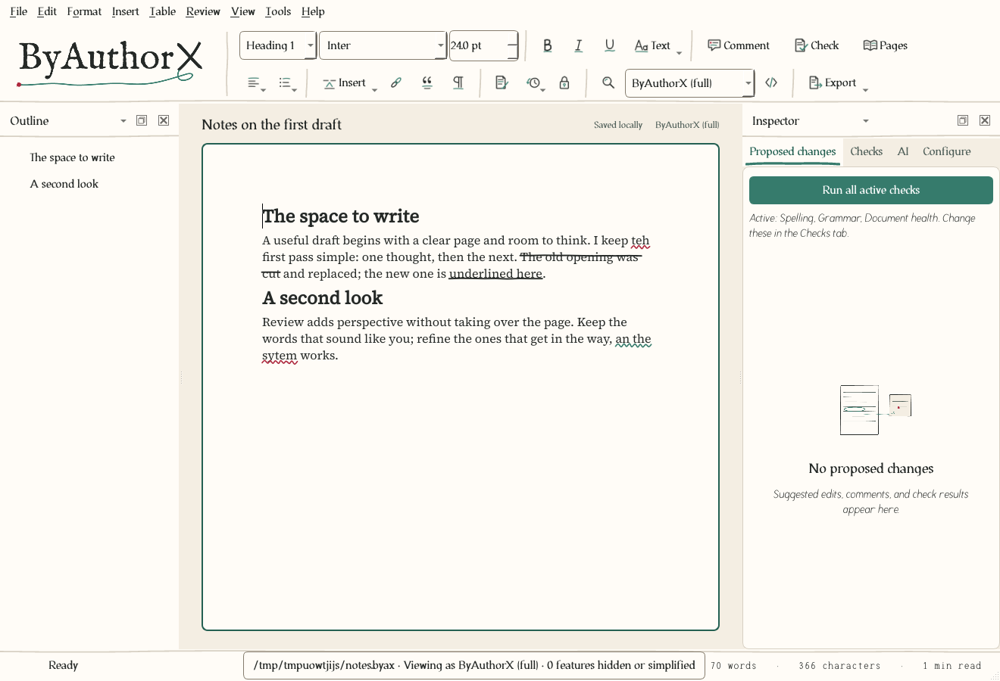

<picture>
  <source media="(prefers-color-scheme: dark)" srcset="docs/images/wordmark-dark.svg">
  
</picture>

# ByAuthorX

**Your words. Your call.**

A desktop word processor for writers, from a first letter to a finished book. Write in a clean, paged editor, keep everything in one editable `.byax` file you own, and share it as PDF, Word, EPUB or Markdown. Suggestions from checks, reviewers and AI arrive as proposals you accept or reject one by one. Nothing changes your text until you say so.


## Why ByAuthorX

- **You own the file.** The `.byax` master keeps your text, styles, images, review notes and history together. Exporting makes a copy and never replaces the master, and every export tells you exactly what a format could not carry.
- **Suggestions, not surprises.** Spelling, grammar, fiction and continuity checks, reviewers' tracked changes and AI edits all arrive as proposed changes. You decide each one.
- **Private by default.** No account, no telemetry, no background network traffic and no update pings. AI is opt-in: nothing leaves your computer until you add a provider and choose to use it, whether that is a hosted service with your own key or a model on your own machine.
- **Built for long work.** A binder with chapters, scenes and notes, a corkboard, writing goals, named drafts you can compare, a codex of characters and places, and EPUB and print-ready PDF output.
- **Citations you can check.** Attach your own research, cite it, and see whether a quotation really appears in its source.
- **Scriptable when you want it.** The same engine sits behind a command line and an MCP server, so anything you can do in the window you can automate. You never need either to write.

## Get started

Download an installer from the [releases page](https://github.com/jxburros/ByAuthorX/releases) and follow the [user guide](docs/user-guide.md). **Help → Open sample project** opens a short worked manuscript to practise on. The [documentation index](docs/README.md) lists everything else: the [CLI reference](docs/cli-reference.md), the [library and citations guide](docs/library-and-citations-guide.md), [providers](docs/providers.md) and [troubleshooting](docs/troubleshooting.md).

## Status

Version 0.4.1 (see the [changelog](CHANGELOG.md)). ByAuthorX is a working application with automated engine, format, provider-contract, desktop and integration tests. Windows 11 x64, Ubuntu 24.04 x64 and macOS 14+ on Apple silicon are the intended installation targets.

What is not yet verified: installers are unsigned unless a release's notes say otherwise, and they have not been run on physical Windows 11, Ubuntu 24.04 or Apple silicon desktops (the macOS port builds in CI and its platform code is unit tested, but no Mac has run it yet). Live model services also need separate verification. The [acceptance matrix](docs/acceptance-matrix.md) records what is verified and what is not. This project does not claim that every scenario in the [product specification](PRODUCT-SPECIFICATION.md) is complete.

## What you can do

The editor gives you a continuous writing view, a paginated preview, an outline, review and layer panels, native file dialogs and printing, formatting, tables and images, find and replace, undo and history, templates, local checks, and dictation. A `.byax` file keeps your text, assets, review and history together. Exporting never replaces it, and imports and lossy exports come with a compatibility report.

The Inspector has four tabs. **Proposed changes** lists pending edits, comments and findings and runs all active checks; **Checks** marks each check (spelling, grammar, document health, information repository, factual accuracy, voice consistency and custom checks) active or inactive; **AI** hosts the assistant with a persisted **Work / Chat** switch; **Configure** holds API keys, information repositories, profiles and export settings. Spelling runs locally with suggestions, exact replacements, a document dictionary, and session-only ignore. Chat mode only answers and never changes the document. Work mode may suggest exact range edits, which are shown to you and, after confirmation, added to Proposed changes as pending proposals; nothing changes until you accept each one. Remote messages show the exact outbound payload for authorization unless the provider's saved policy allows remote calls.

**AI is opt-in, not opt-out.** Nothing sends your writing to a model until you add a provider and choose to use it. You pick the provider: a hosted service with your own key, or a local model that runs on your computer, such as Ollama, whisper.cpp or an OpenAI-compatible local server. Unconfigured AI functions do not prevent writing, saving, printing, or deterministic checks. Each provider requires a chosen model and local configuration; keys stay in OS credential storage or explicit environment references. No accounts, telemetry, or background model polling are required. **Updates are manual too:** ByAuthorX never checks for a new version by itself. Help → Check for updates (or `byax version --check-updates`) makes one request to GitHub's releases page when you ask, and nothing is downloaded or installed. On first run a short tour appears once; **Help → Open sample project** opens a copy of a worked example (see the [user guide](docs/user-guide.md#your-first-minutes)).

## Manuscripts, publishing and review

Tools for book-length work, all inside the same `.byax` file and all local by default:

- **Manuscript projects.** The Binder menu organizes parts, chapters, scenes and notes, with outline and corkboard views, synopses, writing goals, and named drafts you can compare scene by scene.
- **Publishing.** Deterministic EPUB 3 export and import, and File → Compile… with novel, non-fiction and standard-manuscript presets, preflight checks and print-book design.
- **Interchange.** A Word review round trip that returns editors' tracked changes and comments as proposals, beta-reader copies, and synced-folder safety checks.
- **Writing quality and research.** Fiction, readability, offline grammar and continuity checks; a codex of characters and places; library search and citation audits that show what the AI saw and whether a quote really appears in its source.

See the [user guide](docs/user-guide.md) for each workflow and the [changelog](CHANGELOG.md) for the full list.

## File views and appearance

The toolbar's File view selector shows the master as PDF, Word, OpenDocument, EPUB, RTF, HTML,
Markdown or plain text. Format limits appear in the status bar; the source toggle shows exact,
read-only export text. Hidden content stays in the master, and edits to simplified objects are
locked. Word/OpenDocument/RTF previews are approximate. Save keeps the ByAuthorX master and
can offer a separate export. Markdown opens as an import by default; the first-open chooser
and Tools → Markdown opening preference let you keep editing `.md` files directly.

View → Theme selects System, Light or Dark. Theme and view choices are local preferences,
not document revisions. See [the file-view evidence](docs/acceptance-matrix.md#file-view-evidence--14-october-2026)
and [the open-issue audit](docs/issue-audit-2026-10-14.md) for remaining limits.

## Look and feel

Warm paper, quiet ink and familiar controls frame a clean white writing page. The look comes from the logo. The interface font, Irongall, is drawn from the wordmark, and small hand-inked icons and pen-line details help you find your way without touching your text. Motion is brief and appears only while something is happening: a pen loop while work runs, a checkmark when you save. Typing and autosave stay quiet. Choose **View → Reduce motion** for static artwork and immediate transitions; system preferences and `BYAX_REDUCED_MOTION=1` do the same.

Spelling and grammar marks (red pen for spelling, green for grammar), underline and strikethrough are drawn as pen strokes in the writing view. They are interface only: Pages, print and every export keep exact lines. **View → Hand-drawn marks** switches them off. Your document keeps the styles you chose.



See [brand and voice](docs/brand.md) for the design system and how ByAuthorX writes, the [editable brand sources](design/brand/README.md) and the [brand guide](design/brand/kit/ByAuthorX-brand-guide.pdf).

## For developers and automation

ByAuthorX is open source (MIT). The desktop app, command line, MCP server and optional local REST service all call one document engine. See the [architecture](docs/architecture.md), the [development guide](docs/development.md) and [CONTRIBUTING](CONTRIBUTING.md).

### Run from source

Python 3.11 or newer is required for development; frozen distributions include Python.

```bash
uv sync --extra dev
uv run byauthorx
```

Alternatively:

```bash
python -m venv .venv
# Ubuntu:
.venv/bin/python -m pip install -e ".[dev]"
.venv/bin/byauthorx
# Windows PowerShell:
.venv\Scripts\python -m pip install -e ".[dev]"
.venv\Scripts\byauthorx
```

On Ubuntu, install the native Qt dependencies documented in [compatibility](docs/compatibility.md). For headless PNG/PDF rendering set `QT_QPA_PLATFORM=offscreen`. Ordinary CLI editing and inspection need no desktop session.

### CLI

```bash
byax capabilities --json
byax view report.byax --as md --source --json
byax statistics report.byax --format txt --json
byax new --out report.byax --title "Quarterly report" --text "An opening paragraph." --json
byax inspect report.byax --outline --json
byax inspect report.byax --json
byax find report.byax --query "opening" --json
byax context report.byax --limit 10000 --json
byax apply report.byax --input edits.json --dry-run --json
byax apply report.byax --input edits.json --json
byax check report.byax --suite structure --suite requirements --json
byax history report.byax --action checkpoint --name "Before review" --json
byax export report.byax --out report.pdf --json
byax unpack report.byax --out report-source --json
byax pack report-source --out restored.byax --json
```

Create `edits.json` using the identities and revision returned by inspection:

```json
{
  "schema_version": 1,
  "request_id": "edit-001",
  "expected_revision": "COPY_CURRENT_REVISION_HERE",
  "operations": [{
    "type": "replace_text",
    "target": "COPY_PARAGRAPH_ID_HERE",
    "match": "opening",
    "expected_text": "opening",
    "replacement": "revised",
    "occurrence": 1
  }],
  "required_suites": ["structure", "requirements"]
}
```

`byax schema --topic operations --json` exposes the current canonical operations. `--input -` reads UTF-8 JSON from stdin. Machine stdout contains only JSON results; progress/diagnostics belong to stderr. Exit codes: 0 completed under selected policy, 1 execution/dependency, 2 invalid input, 3 conflict, 4 failed required validation, 5 strict incomplete coverage/review, 6 cancelled, 7 pending/uncertain. Advisory findings do not automatically fail writing.

An open GUI holds a document lock. CLI writes fail explicitly while that document is open; the disk file is never silently modified behind unsaved GUI changes. Apply batches are atomic, stale revisions fail, and identical committed request IDs do not apply twice.

### Providers and transcription

Supported adapter kinds are `openai`, `anthropic`, `gemini`, `ollama`, `elevenlabs`, and `whisper.cpp`. Text review is available through OpenAI/Anthropic/Gemini/Ollama; transcription through OpenAI/ElevenLabs/whisper.cpp. Recognition and cleanup models are independently selected. Model names must be selected explicitly; API-compatible endpoints are not assumed to be universally verified.

See [provider setup](docs/providers.md) for configuration, transmission policies and offline transcription. Contract tests mock HTTP responses; no billable calls were required to run this suite.

### MCP and optional local REST

Launch `byax-mcp` as a stdio MCP server, or `byax mcp`. For example:

```json
{"mcpServers":{"byauthorx":{"command":"byax-mcp","args":[]}}}
```

The server exposes the common CLI dispatcher as tools with input schemas. Inspect before editing and preserve revision preconditions. Do not expose the stdio process to untrusted clients.

REST is disabled unless explicitly started. Set a randomly generated `BYAX_SERVICE_TOKEN` with at least 24 characters and run:

```bash
byax serve --root /absolute/authorized/document/folder
```

POST `{"command":"inspect","arguments":{"path":"/absolute/authorized/document/folder/report.byax"}}` to `http://127.0.0.1:8765/v1/execute` with `Authorization: Bearer <token>`. The service rejects non-loopback binding, browser origins, unauthenticated calls, and paths outside the configured roots. Provider configuration and job state live in a reserved `.byax` folder inside the first root; clients cannot select another configuration folder or write into that one, and `providers --action configure` is available only through the local CLI or desktop.

### Tests, fixtures and builds

```bash
QT_QPA_PLATFORM=offscreen uv run pytest -q
uv run python scripts/generate_fixtures.py --out artifacts/fixtures
QT_QPA_PLATFORM=offscreen uv run python scripts/benchmark.py --out artifacts/benchmark.json
uv run python scripts/build.py --bundle-only
```

For Windows PowerShell set `$env:QT_QPA_PLATFORM = "offscreen"` before headless tests. The build script freezes the native GUI, CLI and MCP executables into `dist/ByAuthorX`. Run `python scripts/build_deb.py` **on Ubuntu 24.04** to build the Ubuntu package, or Inno Setup `iscc packaging/windows.iss` on Windows for the Windows 11 installer. CI contains both build jobs, and pushing a `vX.Y.Z` tag publishes the installers as a GitHub Release (see [packaging](docs/packaging.md#cutting-a-release)). A Linux binary built on a newer glibc host is not a validated Ubuntu 24.04 binary.

Build and installation details: [packaging](docs/packaging.md). Architecture: [architecture](docs/architecture.md). Complete requirements: [product specification](PRODUCT-SPECIFICATION.md).

### Creative resources

The [creative library](assets/creative-library/README.md) contains 54 original designs for future app and marketing use: illustrations, icons, loading loops, completion animations, decorations, and backgrounds. It includes light/dark variants, editable Vixl masters, SVG/PNG exports, animation formats, and a local browsable catalog. These are optional assets; Vixl is an authoring tool rather than an app dependency.

The additional [logo companion library](assets/logo-companion-library/README.md) adds 24 designs and 44 variants based on the supplied green pen loop, irregular red ink mark, and canonical brand palette, including a compact ink-mark loader and 180 ms confirmation animations. The app bakes a few of them into `src/byax/resources/brand/ui` for waiting states and empty panels; see [brand](docs/brand.md).

## License

ByAuthorX is a product of JX Holdings, LLC. MIT for ByAuthorX source. Qt/PySide6 and other dependencies retain their licenses; see [third-party notices](docs/third-party-notices.md). Provider services and downloaded model weights are separate integrations.

Library and citation workflows, the expanded ribbon and review checks are described in
[the library and citations guide](docs/library-and-citations-guide.md). Every other document
is listed in the [documentation index](docs/README.md).
