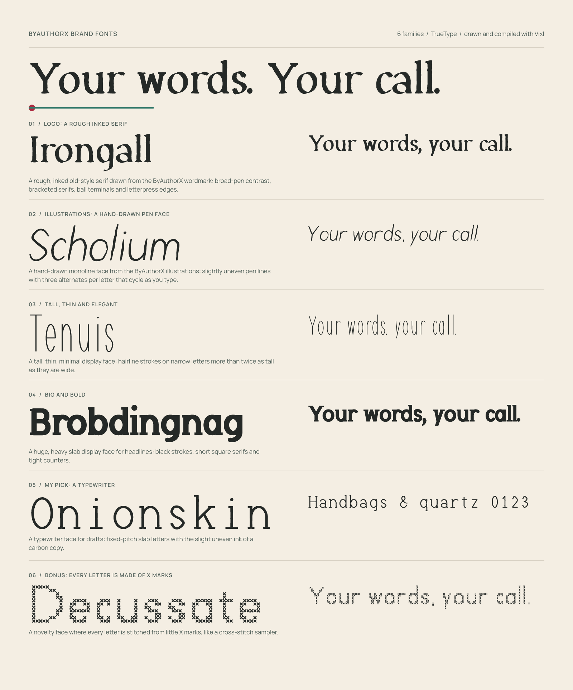

# ByAuthorX brand fonts

Six original typefaces drawn with Vixl for ByAuthorX: two taken from the brand artwork, one tall and thin, one big and bold, one chosen by the designer, and one made of X marks.



| # | Family | Role | Drawn from |
| ---: | --- | --- | --- |
| 1 | **Irongall** | Logo | The wordmark: broad-pen contrast, bracketed serifs, ball terminals and inked, letterpress edges |
| 2 | **Scholium** | Illustrations | The companion-library artwork: an uneven pen line, with three alternates per letter that cycle as you type |
| 3 | **Tenuis** | Tall and thin | Hairline strokes on narrow letters more than twice as tall as they are wide |
| 4 | **Brobdingnag** | Big and bold | An ultra-black slab with short square serifs and tight counters, for headlines |
| 5 | **Onionskin** | My pick | A fixed-pitch typewriter face with the slight uneven ink of a carbon copy, for drafts and manuscripts |
| 6 | **Decussate** | Bonus | Every letter is stitched from little X marks, like a cross-stitch sampler |

Each family is one style. Every font has the same 244 characters: Basic Latin, the accented Latin-1 letters and the common Latin-1 symbols (not the fractions or superscripts), a set of Central European letters, typographic quotes, dashes, ellipsis, bullet, dagger and euro. Kerning is built into all but the two fixed-pitch faces, Onionskin and Decussate; Scholium also has contextual alternates (`calt`). The fonts are unhinted, upright and Latin-only, and have no bold or italic partners.

## Files

```
fonts/<family>/<Family>-<Style>.ttf   desktop and Vixl; also bundled in the app
fonts/<family>/<Family>-<Style>.woff2 web
masters/<family>-glyphs.vixl          the editable vector glyph sheet
specimens/<family>-specimen.vixl/png  a type specimen, also a Vixl document
overview.vixl/png                     the sheet above
manifest.json                         versions, character counts and a SHA-256 for every font
requirements.txt                      the authoring dependencies
```

The fonts are released under the repository's [MIT License](../../LICENSE); the license text is recorded in each font's name table, and the family names are constants in [`scripts/brandfonts/families.py`](../../scripts/brandfonts/families.py), so a different license or name is a one-line change followed by a rebuild.

### Names

The six names were picked because a quick search found no existing typeface with them (an earlier set, Broadside among them, was already in use). That is a sanity check, not a trademark search: look them up in a font catalogue and a trademark register before you publish the fonts outside this project.

## In the application

All six TTFs are bundled with ByAuthorX in `src/byax/resources/fonts`, so they are registered at startup, appear in the document font picker, and ship in the wheel and the frozen builds. The interface uses three of them: Irongall for headings and the About screen, Scholium for helper text, and Onionskin for the status-bar counters, while controls stay in Manrope ([brand and typography](../../docs/brand.md)). A full build copies the fonts into the application itself; `--install-only` re-copies the committed ones, and a test fails if the bundled copies drift from `manifest.json`.

## How they were made

There is no font editor in the loop. Vixl is the drawing tool, and the build script is the compiler.

1. **Skeletons.** Each letter is a handful of centerlines (arcs, splines and lines) described once in [`scripts/brandfonts`](../../scripts/brandfonts) in terms of a family's metrics: x-height, cap height, stroke widths, serifs. Changing a number changes every letter.
2. **Pens.** A stroke is swept by a nib: a slanted flat nib for Irongall's contrast, a circle for a monoline, a squarish blob for Brobdingnag. Irongall's outlines are then roughened with smooth noise, and Scholium's strokes wobble and swell like pen pressure. Decussate rasterises each glyph onto a grid and puts an X in every filled cell.
3. **Spacing and kerning.** Sidebearings and pair kerning are measured from the finished outlines (white area between shapes), not typed in.
4. **Vixl masters.** Every drawn glyph is also written as an ordinary vector path layer in `masters/<family>-glyphs.vixl`, laid out on a grid with metric lines, so the outlines are editable in Vixl like any other artwork.
5. **Vixl specimens.** The compiled fonts are imported into Vixl, set in a specimen and an overview, run through `vixl check` (contrast, spacing, bounds, fonts, composition) and exported. Vixl's own HarfBuzz text engine is what lays the specimens out, so kerning and Scholium's alternates are exercised by the same engine the app uses.

## Edit and rebuild

```bash
python -m venv .venv-assets
.venv-assets/bin/python -m pip install -r assets/brand-fonts/requirements.txt
.venv-assets/bin/python scripts/build_brand_fonts.py                  # everything
.venv-assets/bin/python scripts/build_brand_fonts.py --only tenuis    # one family
```

A full build takes a few minutes, mostly in Vixl. To refine a letter by hand, open `masters/<family>-glyphs.vixl` in Vixl, move its points with the pen tool (leave the layer where it is: the grid cell and the baseline are the glyph's coordinates), save, and compile the fonts from the edited masters:

```bash
.venv-assets/bin/python scripts/build_brand_fonts.py --only tenuis --from-masters
```

Spacing and kerning are recomputed from the edited outlines, and accented letters are rebuilt from their bases. A normal build (without `--from-masters`) redraws the masters from the skeletons and overwrites hand edits, so keep edited masters elsewhere or commit them first.

Using a font in Vixl takes one import, because documents embed the fonts they use:

```bash
vixl font import assets/brand-fonts/fonts/irongall/Irongall-Regular.ttf --name irongall
```

or an `import-font` step with the same `path` and `name` in `vixl_apply`. Then use `"font": "irongall"` in any text operation.
