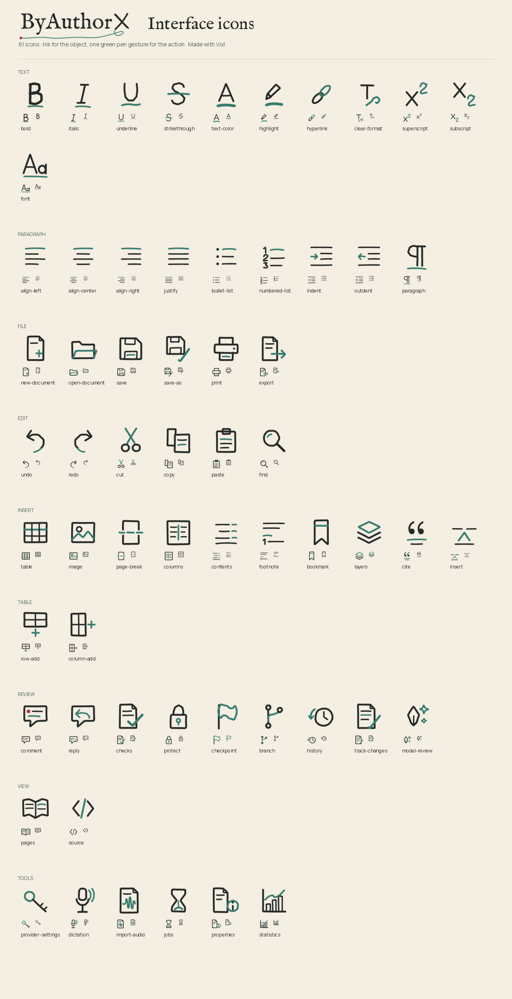
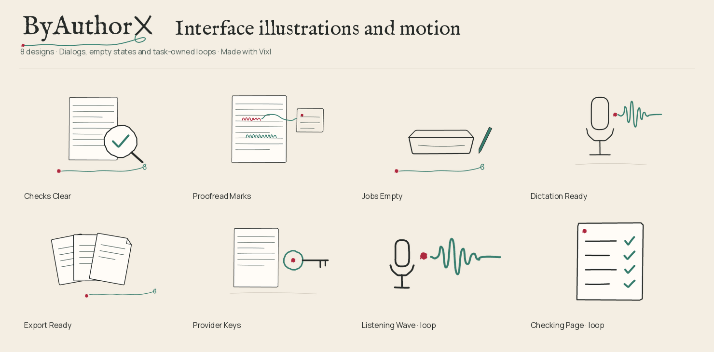

# ByAuthorX logo UI library



The pieces a native word processor needs every day, drawn in the logo's own vocabulary with [Vixl](https://github.com/jxburros/Vixl): hand-inked ink for the object, one green pen gesture for the action, and the red ink blot only where it marks a point of origin. It extends the [logo companion library](../logo-companion-library/README.md) (the same pen line, ink blot and mark, the same palette) and does not replace any of it.

| Category | Designs | What they are for |
| --- | --- | --- |
| `icons/` | 61 × light and dark | Toolbar and menu icons. Always set beside a text label or given an accessible name. |
| `illustrations/` | 6 × light and dark | Dialog headers and empty states: `checks-clear`, `proofread-marks`, `jobs-empty`, `dictation-ready`, `export-ready`, `provider-keys`. |
| `animations/` | 2 × light and dark | Task-owned loops: `listening-wave` (dictation recording) and `checking-page` (document checks running). |
| `rules/` | 3 × light and dark | Quiet hand-inked rules for the chrome: `rule-h`, `rule-v`, `tab-underline`. |



## The icon language

- **96-unit grid, 6-unit ink.** The logo's pen line is 5 units on a 680-unit master. At 24 px an icon's stroke is 1.5 px; at 16 px it is 1 px and still reads.
- **Hand-inked, reproducibly.** Each icon is clean geometry run through seeded wobble (`scripts/logo_ui_art.py`), so strokes bow and corners soften the way the companion pages do, and every rebuild draws the same line.
- **One green gesture.** The ink is the object; the pen-green stroke is the action (the underline under **B**, the check on **Check**, the loop that makes a key's bow). Never more than one major gesture per icon.
- **Red only for a point of origin.** The supplied ink blot appears once in the icon set: the start of a comment.
- **Exact brand colours.** Every icon carries a Vixl `palette` rule: ink, pen green and ink red, with only the anti-aliased blend where green crosses ink (a pixel at most 41 levels from the nearer colour) allowed.
- **No SVG per icon.** Strict SVG export flattens every curve (about 76 KB for a 1.4 KB master). Each `.vixl` master is editable; `vixl -p icons/bold-light.vixl export bold.svg` makes one when needed.

## Files

Each design has an editable Vixl master (`.vixl`) and the exact operation list that built it (`.recipe.json`). Illustrations and animations also ship SVG, `@2x` PNG (illustrations), and WebP/APNG/GIF with a contact sheet (animations). Icons ship `atlas-{theme}-{size}.png` (16, 24, 32 and 48 px, rendered from the vectors, not resampled) and `atlas.json`. `manifest.json` records every design with its Vixl check results; `checksums.json` records every file.

The application does not read this folder. `scripts/build_ui_art.py --companions-only` copies the runtime pieces into `src/byax/resources/brand/ui` with their provenance.

## Rebuild

```bash
python -m venv .venv-assets
.venv-assets/bin/python -m pip install -r assets/logo-companion-library/requirements.txt
.venv-assets/bin/python scripts/build_logo_ui.py                 # everything
.venv-assets/bin/python scripts/build_logo_ui.py --only icons    # icons and atlases only (no manifest)
.venv-assets/bin/python scripts/build_ui_art.py --companions-only  # refresh runtime resources
```

Renders, recipes, atlases and animations are byte-identical between builds. Vixl embeds random layer IDs in `.vixl` masters and SVG, so those files, and the `layer_ids` inside check issues in `manifest.json`, differ on every build without any visible change. `atlas.json` therefore records recipe hashes, which do not.

Every design passes Vixl's `bounds`, `motion` and `composition` checks and an asset contract (editable vector layers, no baked text). The only findings left are informational and deliberate: the numbered-list and contents icons record a waiver because evenly spaced rows are their subject, and the rules run edge to edge by design.

## Adding to it

Add the drawing to `scripts/logo_ui_icons.py` (or `logo_ui_scenes.py`), run the build, and read the contact sheet at real size before anything else: look at the 24 px and 16 px renders, not only the large one. Keep one pen gesture per design, keep the red blot to a point of origin, and keep text out of artwork.
