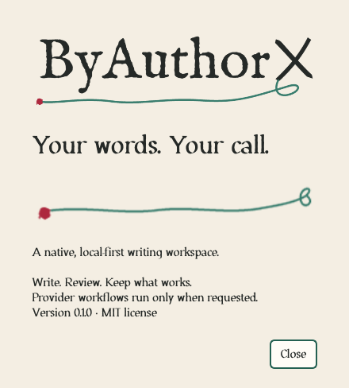

# ByAuthorX identity and native motion

<picture>
  <source media="(prefers-color-scheme: dark)" srcset="images/wordmark-dark.svg">
  
</picture>

**Your words. Your call.** The supplied brand guide describes a working manuscript: warm, useful, and calm. Expressive marks introduce the app; familiar controls frame the author's writing.


## Tokens and typography

[`src/byax/resources/brand/tokens.json`](../src/byax/resources/brand/tokens.json) is the canonical runtime source. `byax.brand` reads it for the application palette, stylesheet, font roles, and animation duration. The original kit's JSON/CSS remain reference copies. Do not change the approved logo colors when adjusting neutral UI surfaces.

| Role | Value | Use |
| --- | --- | --- |
| Paper | `#F4EEE3` | Chrome and preview surround |
| Ink | `#252927` | Main text |
| Pen green | `#367B6C` | Primary buttons and supplied gestures |
| Ink red | `#AD283E` | Signature artwork; errors also need explicit labels |
| Surface | `#FFFCF7` | Menus, controls, and inspector surfaces |
| Rule | `#D7D0C3` | Quiet separators |
| Muted | `#52615B` | Secondary labels |
| Deep green | `#246052` | Small green text, selections, and focus rings |

Controls use a 6 px radius; panels use 8 px. Layout uses the supplied 4/8 px rhythm. A 2 px deep-green focus border identifies keyboard focus. Primary green buttons carry white text. Color never replaces the control label.

The native workspace keeps a professional control layer: Manrope labels, restrained toolbar buttons, plain panel headings, and a white writing surface within warm-paper margins. The document header reports its title, save state, and current view. Outline and Inspector start at 230 and 300 px and remain resizable. Selected paragraph styles have readable labels while retaining canonical engine keys.

When Review has no active items, a small static illustration from the logo companion library accompanies a clear explanation and a local-checks action. Real items replace that empty state; reply/accept/reject controls enable only when the selected item supports them. Interface artwork stays outside authored content and exports.

Other empty states use companion stills in the same way, always beside a readable heading and explanation:

| Surface | Companion design | Runtime file (`ui/`) |
| --- | --- | --- |
| Outline with no headings | `loop-bound-book` | `outline-empty-{light,dark}.png` |
| Layers with no layers | `revision-pages` | `layers-empty-{light,dark}.png` |
| AI chat before the first message | `idea-on-paper` | `ai-empty-{light,dark}.png` |
| AI chat with no provider configured | `local-copy` | `ai-setup-{light,dark}.png` |
| Spelling check with no misspellings | `signature-manuscript` | `spelling-clean-{light,dark}.png` |

`gui_art.themed_art()` chooses the light or dark variant from the effective window palette (window lightness below 50% selects dark). The current application palette is light, so dark variants are dormant until a dark palette ships.

Manrope Regular/Semibold provides interface type (11 pt by default). IM FELL English appears in the About headline. Source Serif 4 is registered and selectable for reading/document styles. All three families are bundled with their SIL OFL notices. Existing document styles, content, revision history, and export typography are preserved; branding does not inject decoration into authored documents. The writing page stays white.

Six custom display faces drawn with Vixl live in [assets/brand-fonts](../assets/brand-fonts/README.md): Irongall (from the wordmark), Scholium (from the companion illustrations), Tenuis (tall and thin), Brobdingnag (big and bold), Onionskin (a typewriter face) and Decussate (every letter stitched from X marks). They are design assets for artwork and marketing, with editable Vixl glyph masters and checked specimens. The application does not bundle or load them, and the interface and document typography above are unchanged.

## Logos and platform icons

The full light wordmark appears at 240 px in the writing toolbar, with 20 px surrounding clearance, and at 360 px in About. Preserve aspect ratio, the loop, the rough terminal, and at least half a capital B's height of clear space. The approved name is outlined artwork; do not retype or redraw it as a substitute.

Qt's SVG Tiny renderer skips nested SVG elements in these supplied exports. Native widgets therefore draw the supplied 960 px transparent wordmark PNG at its intended logical size, preserving fidelity through common display scales. Original SVG and Vixl masters remain available for design and documentation. The README and this page use light/dark SVG variants via `picture`.

The Qt application icon uses the simplified micro mark at 16–24 px and the X/loop mark at larger sizes. The runtime contains PNG sizes through 1024 px. Windows executable/installer icons use the supplied multiresolution ICO. Linux packaging installs the scalable transparent master plus matching hicolor PNG sizes. Avatars and social previews are available in `design/brand/social`; website manifests and duplicate raster export families are not part of the native desktop build.

## Motion contract

| Trigger | Motion | Completion |
| --- | --- | --- |
| Writing/pages switch | New view fades from 35% to full opacity | 180 ms, ease out |
| Inspector tab change or dock reveal | Panel content fades in | 180 ms, ease out |
| Background worker or durable job | Small green pen loop writes, holds, and erases beside the task label | 2.4 s loop, only while work is pending |
| Explicit successful save | Small checkmark draws beside “Saved locally” | 180 ms, then holds briefly and hides |
| About opens | Original green signature stroke writes itself once | 180 ms, ease out |
| AI assistant request in flight | Red ink blot (`ink-blot-loader`) breathes beside “… is thinking” in the AI tab | 2.4 s loop, only while the request is pending |
| Spelling check running | Green margin gesture (`margin-review`) writes and erases beside **Check spelling** | 2.4 s loop, only while the check runs |

Qt `QPropertyAnimation` uses `OutCubic` for interface fades. Vixl-authored artwork uses a linear playback clock because its stroke timing is already baked. About and save feedback include the exact 180 ms endpoint; their original centerlines, proportions, stroke widths, and colors are preserved. Finished fade effects are removed. Rapid view switches settle at full visibility. Typing, autosave, and idle time do not trigger artwork.

Busy artwork appears after a 200 ms delay to avoid flashing on quick tasks. A reserved status-bar slot prevents layout shifts. Overlapping workers/jobs keep one indicator active until the last task finishes; completion, cancellation, uncertainty, failure, and polling errors clear the corresponding activity. The loop stops when hidden or minimized. Explicit save confirmation never interrupts a running task, and its artwork hides after 1.2 s.

The AI tab's two loops are `gui_art.TaskLoop` widgets owned by a single task: `start()` shows and plays, `stop()` hides. They stop while hidden or minimized, never run as ambient decoration, and under reduced motion draw the delivered still instead (the fully written hold pose at 1.2 s). The status-bar pen loop still reports the same work globally; the tab-local loop shows where the result will appear. The existing `saved-ink` checkmark remains the save confirmation; the companion shelf's `saved-ink` and `pen-loop-wait` are already the sources for those profiles.

Native previews show [work in progress](images/editor-busy.png), [explicit save confirmation](images/editor-saved.png), and [a populated review panel](images/editor-review.png). The review illustration gives way to the author's actual review items.

**View → Reduce motion** persists in local QSettings. When enabled, changes appear immediately and active transitions finish immediately. `BYAX_REDUCED_MOTION=1` forces the same behavior for managed desktops or headless runs. Qt accessibility motion preferences, where exposed by the installed Qt/platform combination, also force reduced motion and update live. The preference cannot override an active system/environment request for reduced motion. On older Qt builds without accessibility motion hints, use the menu or environment setting.



## Authoring with Vixl

The integrated profiles come from the [logo companion library](../assets/logo-companion-library/README.md): `pen-loop-wait`, `saved-ink`, `signature-settle`, `ink-blot-loader`, `margin-review`, and the static `margin-notes`, `idea-on-paper`, `local-copy`, `signature-manuscript`, `revision-pages`, and `loop-bound-book` illustrations. Only these runtime PNG/JSON files are copied into the package; the full shelf (masters, recipes, SVG, WebP/APNG/GIF exports) stays in `assets/`. Their editable masters retain original pen centerlines and writing/erasing tracks. Native assets live in `src/byax/resources/brand/ui`; each sprite manifest records its source hash, timing, crop, selected layers, loop mode, poster time, and Vixl check results.

Install Vixl into the separate authoring environment, regenerate a companion master if needed, then bake the selected profiles:

```bash
python -m venv .venv-assets
.venv-assets/bin/python -m pip install -r assets/logo-companion-library/requirements.txt
.venv-assets/bin/python scripts/build_ui_art.py
```

On Windows use `.venv-assets\Scripts\python.exe`. The bake script renders all frames in Vixl, crops only transparent margins, and uses Pillow to arrange those frames into PNG sprites. The save profile selects only its checkmark and ink accent so the status bar carries no miniature document illustration. Busy motion includes the exact loop endpoint; finite motion includes the exact completed pose. Poster PNGs are independent of the final frame so reduced-motion waiting states remain fully drawn. The application and frozen builds use these committed PNG/JSON resources, with no Vixl runtime dependency or animation-format plugin requirement.

The AI-tab loops and empty-state stills do not need Vixl: `scripts/build_ui_art.py --companions-only` unpacks the delivered transparent APNG frames with Pillow (no resampling), crops transparent margins, closes each loop on its opening pose, uses the delivered reduced-motion PNG as the poster, and copies the illustration PNGs. Each manifest records the APNG and poster hashes and the library's Vixl check result; `provenance.json` records each still's source and hash. A full `build_ui_art.py` run also refreshes them.

The earlier [pen-settle experiment](../design/brand/motion/pen-settle.vixl), its contact sheet, and `scripts/build_brand_motion.py` remain as source references. They do not rebuild the current `ui/` profiles.

## Verification

The [editable sources](../design/brand/README.md) preserve the supplied guide, examples, and new timeline. Vixl is the animation authoring tool; native playback stays in `gui_motion.py`. Preserve the immediate reduced-motion path when adding transitions.

`tests/test_brand_motion.py`, `tests/test_ui_art.py`, and `tests/test_gui_ai.py` exercise resources, companion provenance and loop endpoints, palette-based variant choice, task-owned AI/spelling loops, exact sprite endpoints, completion/interruption, reduced motion, hidden/minimized windows, concurrent workers, terminal job states, explicit save versus autosave, style-key mapping, and document preservation. Existing GUI and engine tests remain required. Screenshots are captured from Qt's offscreen native renderer using a sample document; its Source Serif 4 style is an explicit specimen choice. The busy capture holds a local task open for inspection. Windows installer appearance, Linux desktop icon caches, screen-reader announcements, and physical high-DPI displays require target-desktop verification.
