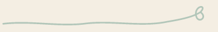

# ByAuthorX identity and native motion

<picture>
  <source media="(prefers-color-scheme: dark)" srcset="images/wordmark-dark.svg">
  
</picture>

**Your words. Your call.** The supplied brand guide describes a working manuscript: warm, useful, and calm. Expressive marks introduce the app; familiar controls frame the author's writing.


## Tokens and typography

[`src/byax/resources/brand/tokens.json`](../src/byax/resources/brand/tokens.json) is the canonical runtime source. `byax.brand` reads it for the application palette, stylesheet, font roles, and animation duration. The original kit's JSON/CSS remain reference copies. Do not change the approved logo colors when adjusting neutral UI surfaces.

| Role | Value | Use |
| --- | --- | --- |
| Paper | `#F4EEE3` | Chrome and preview surround |
| Ink | `#252927` | Main text |
| Pen green | `#367B6C` | Primary buttons and supplied gestures |
| Ink red | `#AD283E` | Signature artwork; errors also need explicit labels |
| Surface | `#FFFCF7` | Menus, controls, and inspector surfaces |
| Rule | `#D7D0C3` | Quiet separators |
| Muted | `#52615B` | Secondary labels |
| Deep green | `#246052` | Small green text, selections, and focus rings |

Controls use a 6 px radius; panels use 8 px. Layout uses the supplied 4/8 px rhythm. A 2 px deep-green focus border identifies keyboard focus. Primary green buttons carry white text. Color never replaces the control label.

Manrope Regular/Semibold provides interface type (11 pt by default). IM FELL English appears in the About headline. Source Serif 4 is registered and selectable for reading/document styles. All three families are bundled with their SIL OFL notices. Existing document styles, content, revision history, and export typography are preserved; branding does not inject decoration into authored documents. The writing page stays white.

## Logos and platform icons

The full light wordmark appears at 240 px in the writing toolbar, with 20 px surrounding clearance, and at 360 px in About. Preserve aspect ratio, the loop, the rough terminal, and at least half a capital B's height of clear space. The approved name is outlined artwork; do not retype or redraw it as a substitute.

Qt's SVG Tiny renderer skips nested SVG elements in these supplied exports. Native widgets therefore draw the supplied 960 px transparent wordmark PNG at its intended logical size, preserving fidelity through common display scales. Original SVG and Vixl masters remain available for design and documentation. The README and this page use light/dark SVG variants via `picture`.

The Qt application icon uses the simplified micro mark at 16–24 px and the X/loop mark at larger sizes. The runtime contains PNG sizes through 1024 px. Windows executable/installer icons use the supplied multiresolution ICO. Linux packaging installs the scalable transparent master plus matching hicolor PNG sizes. Avatars and social previews are available in `design/brand/social`; website manifests and duplicate raster export families are not part of the native desktop build.

## Motion contract

| Trigger | Motion | Completion |
| --- | --- | --- |
| Writing/pages switch | New view fades from 35% to full opacity | 180 ms, ease out |
| Inspector tab change or dock reveal | Panel content fades in | 180 ms, ease out |
| Explicit successful save | “Saved locally” fades in | 180 ms, ease out |
| About opens | Vixl-authored pen line fades from 35% and settles upward 4 source pixels | 180 ms, ease out |

Qt `QPropertyAnimation` uses `OutCubic` for interface fades. The custom About gesture is authored and rendered in Vixl using its `ease-out` curve; Qt advances a linear clock through 12 baked transparent frames, including the exact final pose. Its original filled-vector geometry and color remain intact. Transitions are finite and do not block typing or change document state. Finished fade effects are removed. Rapid view switches restart the relevant fade and settle at full visibility. No typing, autosave, or idle loop triggers decorative motion.

**View → Reduce motion** persists in local QSettings. When enabled, changes appear immediately and active transitions finish immediately. `BYAX_REDUCED_MOTION=1` forces the same behavior for managed desktops or headless runs. Qt accessibility motion preferences, where exposed by the installed Qt/platform combination, also force reduced motion and update live. The preference cannot override an active system/environment request for reduced motion. On older Qt builds without accessibility motion hints, use the menu or environment setting.


## Authoring with Vixl



The new [Vixl master](../design/brand/motion/pen-settle.vixl) retains editable opacity and translation tracks. [The contact sheet](../design/brand/motion/contact-sheet.png) shows 0, 90, and 180 ms. [The saved check report](../design/brand/motion/checks.json) passes Vixl's bounds and motion checks with no warnings. The timeline plays once and has no sound.

Install the authoring tool and rebuild the master, preview, transparent sprite sheet, static reduced-motion pose, and timing manifest:

```bash
uv tool install https://github.com/jxburros/Vixl/archive/refs/tags/v0.26.0.tar.gz
uv run python scripts/build_brand_motion.py
```

The script uses the installed `vixl` CLI to apply the saved operation recipe to the supplied source master, validate motion, render each sample, and export the GIF. Pillow only arranges the Vixl-rendered frames into a sprite sheet. `pen-settle.json` records timing and the master hash. The committed outputs let the app run without installing Vixl or importing its engine. Modify `pen-settle.operations.json` and rebuild to revise the motion. Editing the generated master directly in Vixl is also possible; rerunning the build script replaces it from the source and recipe.

## Verification

The [editable sources](../design/brand/README.md) preserve the supplied guide, examples, and new timeline. Vixl is the animation authoring tool; native playback stays in `gui_motion.py`. Preserve the immediate reduced-motion path when adding transitions.

`tests/test_brand_motion.py` exercises resource/font availability, animation completion, interruption by reduced motion, rapid view switches, and preservation of document state. Existing GUI and engine tests remain required. Screenshots above are captured from Qt's offscreen native renderer using a sample document; its Source Serif 4 style is an explicit specimen choice. Windows installer appearance, Linux desktop icon caches, screen-reader announcements, and physical high-DPI displays require target-desktop verification.
