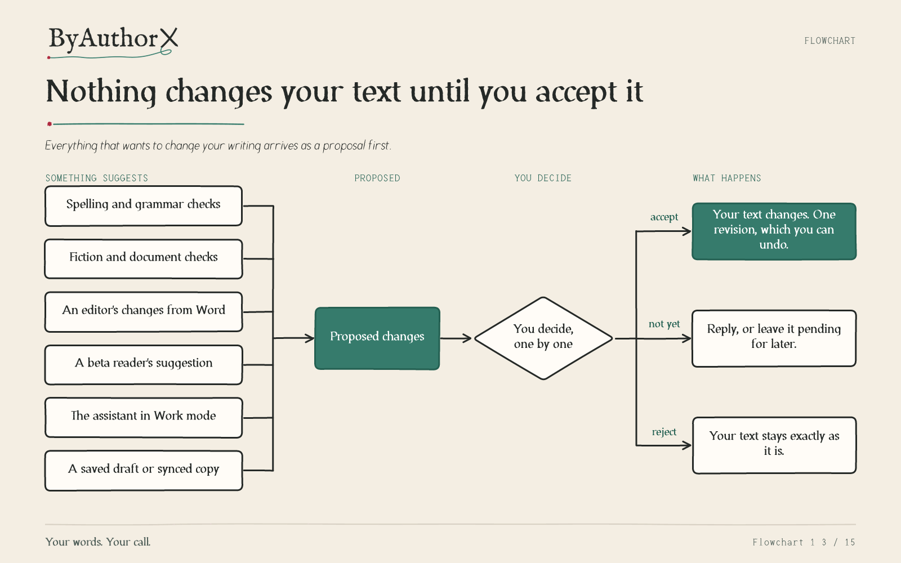
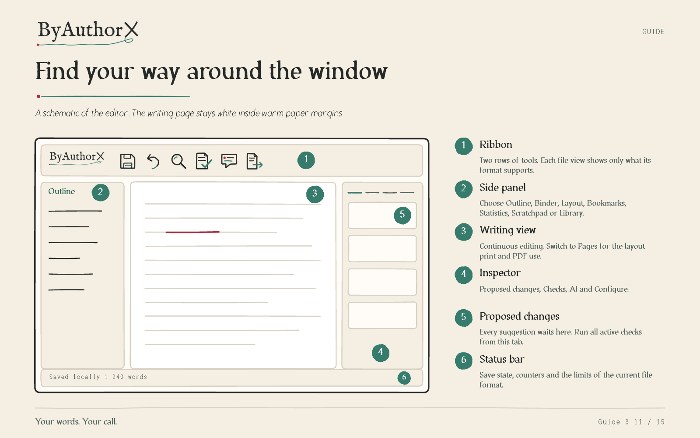

# Visual guides

Flowcharts and one-page guides that explain how ByAuthorX works, in the look of the app: warm paper, quiet ink, pen green, Irongall type and the approved wordmark, icons and illustrations. Each page was authored and checked in Vixl and ships as an editable `.vixl` master, a PNG and an SVG. The context engine, which decides what the assistant sees and lets you check it, has three pages of its own. Read them all together in the booklet, [ByAuthorX at a glance (PDF)](ByAuthorX-at-a-glance.pdf).

The text of every page comes from the [user guide](../user-guide.md), the [library and citations guide](../library-and-citations-guide.md), [providers](../providers.md) and [troubleshooting](../troubleshooting.md). If a page here disagrees with those, the written documentation wins; please report it.

## Flowcharts

| Page | Answers | Files |
| --- | --- | --- |
| Nothing changes your text until you accept it | Where do suggestions go, and who decides? | [PNG](png/proposals.png) · [SVG](svg/proposals.svg) · [Vixl](vixl/proposals.vixl) |
| What the assistant sees for each request | How does the context engine choose what to send, and where can I look? | [PNG](png/context-flow.png) · [SVG](svg/context-flow.svg) · [Vixl](vixl/context-flow.vixl) |
| How do I share this? | Which File command fits an editor, readers, a printer or a plain copy? | [PNG](png/share.png) · [SVG](svg/share.svg) · [Vixl](vixl/share.vixl) |
| From manuscript to book | How do binder, drafts and Compile fit together? | [PNG](png/manuscript-to-book.png) · [SVG](svg/manuscript-to-book.svg) · [Vixl](vixl/manuscript-to-book.vixl) |
| AI is opt-in, not opt-out | How do I turn AI on, and what happens next? | [PNG](png/ai-opt-in.png) · [SVG](svg/ai-opt-in.svg) · [Vixl](vixl/ai-opt-in.vixl) |
| Two computers, one manuscript | What do I do when a synced save is refused? | [PNG](png/synced-folders.png) · [SVG](svg/synced-folders.svg) · [Vixl](vixl/synced-folders.vixl) |



## Guides

| Page | Answers | Files |
| --- | --- | --- |
| Meet the context engine | What is it, and what does it do for me? | [PNG](png/context-engine.png) · [SVG](svg/context-engine.svg) · [Vixl](vixl/context-engine.vixl) |
| Use the context engine | How do I set it up, read it and check its citations? | [PNG](png/context-use.png) · [SVG](svg/context-use.svg) · [Vixl](vixl/context-use.vixl) |
| Find your way around the window | What are the ribbon, panels and Inspector for? | [PNG](png/the-window.png) · [SVG](svg/the-window.svg) · [Vixl](vixl/the-window.vixl) |
| Your first minutes | What do I do after installing? | [PNG](png/first-minutes.png) · [SVG](svg/first-minutes.svg) · [Vixl](vixl/first-minutes.vixl) |
| Checks at a glance | Which checks run, and where? | [PNG](png/checks.png) · [SVG](svg/checks.svg) · [Vixl](vixl/checks.vixl) |
| Your file, your copies | Which format or command do I want? | [PNG](png/files-and-formats.png) · [SVG](svg/files-and-formats.svg) · [Vixl](vixl/files-and-formats.vixl) |
| Private by default | What does ByAuthorX promise about privacy? | [PNG](png/private-by-default.png) · [SVG](svg/private-by-default.svg) · [Vixl](vixl/private-by-default.vixl) |



## Rebuild

The pages are generated by [`scripts/build_visual_guides.py`](../../scripts/build_visual_guides.py) in the same authoring environment as the brand fonts and logo libraries. Edit the text or the diagram nodes in the script, rebuild, and check the PNGs.

```bash
python -m venv .venv-assets
.venv-assets/bin/python -m pip install -r assets/brand-fonts/requirements.txt
.venv-assets/bin/python scripts/build_visual_guides.py              # all pages and the booklet
.venv-assets/bin/python scripts/build_visual_guides.py --only share # one page
```

Each page runs through Vixl's bounds, contrast and composition checks as it is built, and the script exits non-zero if one fails. The flowcharts use Vixl's diagram layout, so adding a node re-routes the connectors for you. Wordmark, icons and illustrations are copied from [design/brand](../../design/brand/README.md) and the [logo UI library](../../assets/logo-ui-library/README.md), never redrawn. Pages stay in the brand voice: calm, plain, and honest about what is not yet verified. See [brand, voice and motion](../brand.md).
